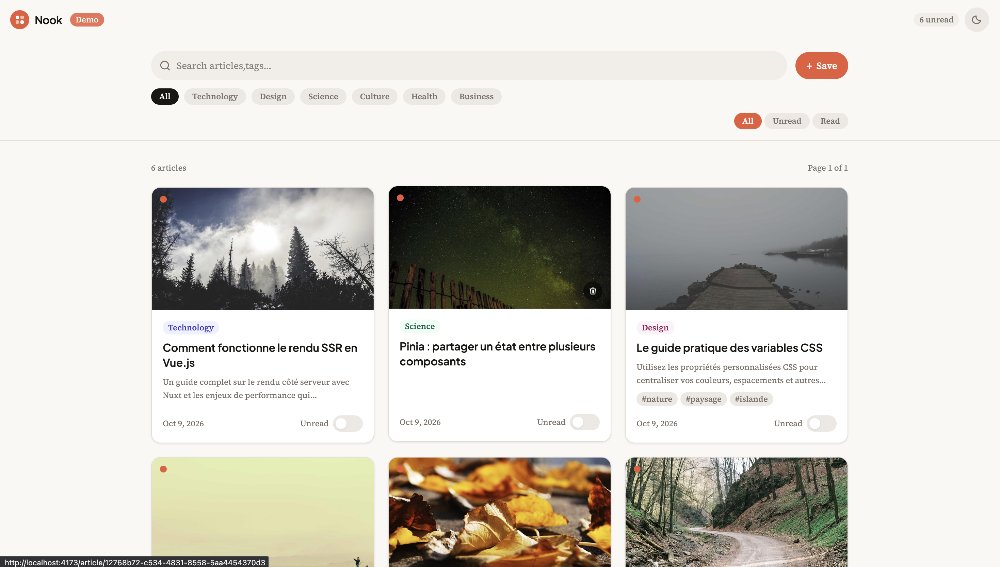
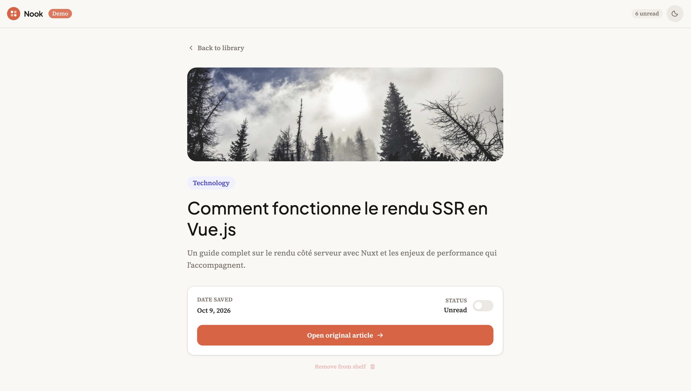
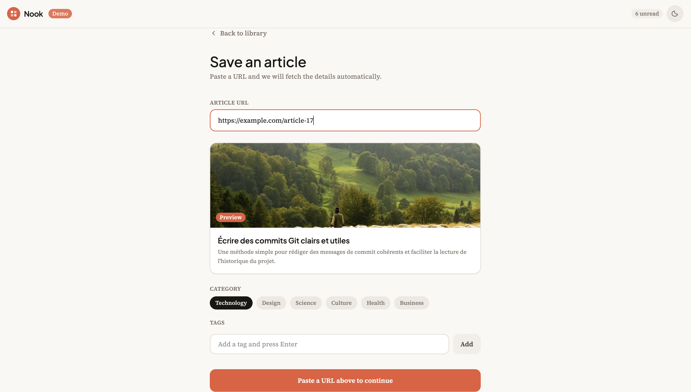

# Nook

A personal space to save and organize articles to read later.

## Overview

Nook is a Vue.js application that allows users to save articles by adding their URLs to a personal reading list.

When an article is added, Nook retrieves its metadata and displays it as a card. Users can then browse, sort, and manage their saved articles.

The project was built to practice Vue.js, state management, and API integration in a frontend-only application.

## Features

- Save articles using their URLs
- Retrieve article metadata from their URLs
- Display saved articles as cards
- Sort saved articles
- Manage a personal reading list
- Read saved articles later

## Tech Stack

- Vue.js
- TypeScript
- Vue Router
- Pinia
- Vite

## API

Nook uses OpenGraph.io to retrieve metadata from article URLs, such as titles, descriptions, and images.

Since Nook is a frontend-only application, the public version uses mock data instead of exposing the OpenGraph.io API key in the client-side application.

## Installation

### 1. Clone the repository

```bash
git clone https://github.com/NIGHTLePoulet/nook.git
cd nook
```

### 2. Install dependencies

```bash
npm install
```

### 3. Start the development server

```bash
npm run dev
```

## Screenshots

### Home page



### Article details



### Create an article



## What I Learned

This project helped me improve my understanding of:

- **Typing real data with TypeScript.** Defining `Article` and `OgMetadata` interfaces up front gave me a single contract shared by the store, the services and the components, and caught shape mismatches at compile time.
- **Centralized state with Pinia.** Articles, read/unread status and persistence (localStorage) live in one store, so every view stays in sync without prop drilling.
- **Isolating an external dependency.** The Open Graph API sits behind a dedicated service, with a mock layer selected per environment. I could build and test the whole UI without depending on the network or exposing an API key in a static build, and the demo never breaks because of a third-party quota.
- **Client-side search and filtering.** A single search covers title, description, category and tags, combined with category and tag filters and read/unread status, all derived reactively with `computed`.
- **Pagination built from scratch.** I worked out the slicing logic myself instead of installing a library, which meant making it play well with filters and search.
- **Mobile-first, responsive design.** I started from the small screen and layered up with Tailwind breakpoints, using a fluid grid rather than a pile of manual breakpoints.
- **Navigation with Vue Router.** Separate views for the library, the add form and the article detail, with routes based on a stable article `id`.

## Known issues

- Filter/toolbar state is not restored when navigating back from the detail view.

## License

This project is for learning and portfolio purposes.
